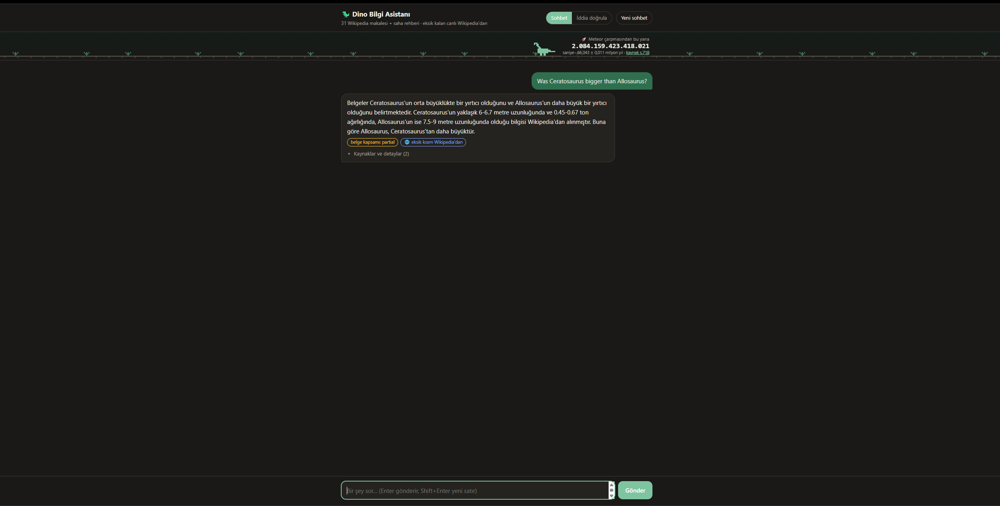
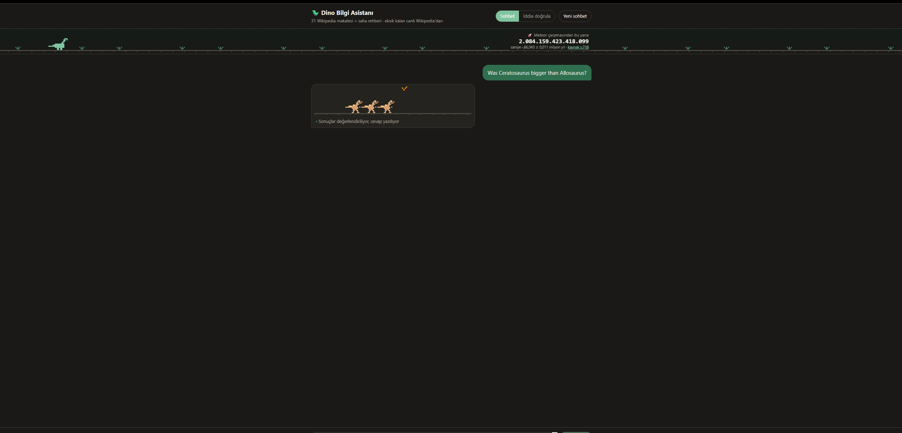
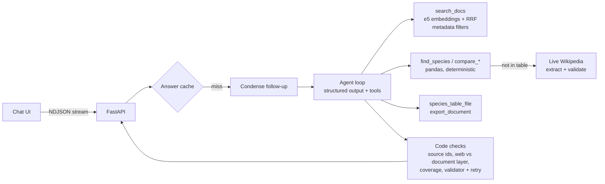

# 🦖 Dino Knowledge Assistant

An agentic **RAG + tool-calling** assistant that answers questions about dinosaurs from a 788-page document corpus and
**cites the page every claim comes from**. When the documents don't cover something, it says so and fills the gap
from live Wikipedia, labeled as an outside source. It can also build data tables and documents (Excel / Word / PDF) on
request. Every change was measured against an evaluation set.

Built as a learning project for production-style LLM engineering: retrieval, structured outputs, function calling,
evaluation, and a FastAPI service with a streaming chat UI.



## What it does

| | |
|---|---|
| **Grounded answers** | Answers are split into layers: *what the documents say* (with clickable PDF page links), *inference*, *live web facts*, *debated points*, *not in the documents*. |
| **Documents first, web second** | Live Wikipedia lookups are only allowed after the documents were searched. This is enforced in code, not just in the prompt. |
| **Tool calling** | 7 typed tools (strict JSON schema): document search, species table queries (pandas, no raw SQL), deterministic size/timeline comparison, live Wikipedia lookup, multi-genus table builder, document export. |
| **Files on request** | *"All ceratopsids with their periods as Excel"*: the model only picks the genus names. Code looks up every value, computes the geological period, and writes the file with a source for every row. |
| **Conversation** | Multi-turn chat. Follow-up questions ("did it eat Allosaurus?") are rewritten into standalone queries before retrieval. |
| **Measured** | 83-question golden set, 30-claim fact-check set, LLM-as-a-judge metrics, ablation runs, run-to-run noise analysis. |

## Architecture
While the agent works, the chat shows its live steps (streamed from the API). A herd of pixel Ceratosaurus waits for the meteor, which hits the moment the answer arrives.





Design rules that came out of the evaluation runs:

- **The LLM decides, code acts.** Gap tickets, file contents, ratios, and periods are all produced by code from
  validated data. The model never writes a number into a file.
- **Prompt rules that failed became schema fields or code checks.** One example: the model sometimes presented
  Wikipedia values as document facts. The fix was a required `document_says` field, plus a check that moves claims
  whose sources are web-only out of the document layer, plus a validator that rejects document-layer numbers found
  only in web results and asks the model to fix them (one retry).
- **Ranges stay ranges.** "6-12 t vs 8 t" is reported as *comparable*, not "bigger".

## Results

Golden set: 83 questions, including myths, false premises, out-of-scope questions, Turkish queries, and conflicting
sources. Judges are LLM-based. Run-to-run noise is about ±0.03.

| Metric | Value |
|---|---|
| Answer correctness | **0.95** |
| Correct refusals (answer not in documents) | **1.00** |
| Tool selection accuracy | **1.00** |
| Correct source cited | **0.97** |
| Faithfulness (claims supported by retrieved context) | 0.75 |
| Claim verification accuracy (30 claims) | 0.93 |
| Retrieval hit@1 / hit@3 / MRR (76 questions) | 0.62 / 0.83 / 0.73 |
| Tool calls per question (baseline → final) | 1.67 → 1.21 |
| Cost per question | ~$0.004 (gpt-4.1-mini) |

Live-tools set (5 questions, so read it as a sanity check): with live tools enabled, correct tool use went from 0.20
to 1.00, and faithfulness from 0.48 to 0.85.

Ablation steps (each one adds a single change): extraction fix → search spillover → schema v2 (coverage, code-opened
tickets) → live Wikipedia. Spillover alone hurt refusals (0.86 → 0.71), and schema v2 brought them back to 1.00.

*The latest latency work (no second LLM rewrite of agent-written queries, streaming steps, answer cache) was checked
with unit tests and the step timeline. It was not re-run on the full golden set.*

## Run it

```bash
python -m pip install -r requirements.txt
cp .env.example .env            # then fill in LLM_BASE_URL, LLM_API_KEY, LLM_MODEL
```

Embedding model (local, CPU): download `intfloat/multilingual-e5-small` into `models/multilingual-e5-small`,
or set `EMBED_BACKEND=api`.

Corpus: `data/dinosaur_field_guide.pdf` (a short fictional field guide) is included. The Wikipedia part
(`data/Dinozorlar.pdf`, 31 articles compiled into one PDF with one bookmark per article, ~39 MB) is not in the repo.
To rebuild it, export these articles as PDF and merge them with a bookmark per article:

> Allosauridae · Ankylosauria · Archaeopteryx · Ceratopsidae · Ceratosauria · Chicxulub crater ·
> Cretaceous–Paleogene extinction event · Deccan Traps · Dinosaur · Dinosaur egg · Dromaeosauridae ·
> Feathered dinosaur · Hadrosauridae · Jurassic · Maiasaura · Megalosauroidea · Origin of birds · Ornithischia ·
> Physiology of dinosaurs · Saurischia · Sauropoda · Spinosauridae · Stegosauria · Theropoda · Triassic ·
> Triassic–Jurassic extinction · Triceratops · Troodontidae · Tyrannosauridae · Tyrannosaurus · Velociraptor

Wikipedia text is available under [CC BY-SA 4.0](https://creativecommons.org/licenses/by-sa/4.0/).

Then:

```bash
python -m dino        # menu: 1 app · 2 experiments · 3 last report · 4 tests · 5 build index · 6 Wikipedia check
```

Build the index once (menu 5), then open the app (menu 1) at http://127.0.0.1:8000.
API docs: http://127.0.0.1:8000/docs.

Tests run without an LLM or network (mocked):

```bash
python -m pytest -q
```

## Project layout

```
dino/
  agent.py       agent loop, prompts, code checks, progress events
  tools.py       typed tools, species table, live lookup chain, table builder
  retrieval.py   e5 dense retrieval, RRF, metadata filters
  ingest.py      PDF parsing (bookmark-based article split), chunking, index
  extract.py     structured extraction of sizes/ages from the corpus, validated in code
  wiki_live.py   live Wikipedia API + the same validation pipeline, cached
  factcheck.py   claim verification with quote checking
  export.py      PDF / Word / Excel generation from validated answers
  eval.py        golden-set evaluation, LLM judges, HTML reports
  api.py         FastAPI: /ask, /ask/stream, /check, /exports, sessions, answer cache
  static/        chat UI (vanilla JS, pixel-art loading scene)
data/            golden sets, claims, species table, field guide
tests/           unit tests + a mock OpenAI-compatible server
```

## License

MIT. See [LICENSE](LICENSE).
